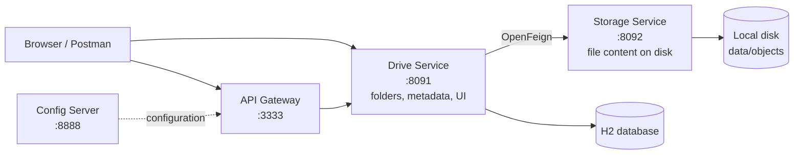

# Drive: Microservices File Storage System

A Google Drive-style app built while learning microservices. You can create folders, upload files, download them and delete them, through a REST API or a simple web UI.

The project is split into four Spring Boot services that each do one job and talk to each other over HTTP.

## Architecture



| Service | Port | Responsibility |
|---|---|---|
| `config-server` | 8888 | Central configuration, read from a Git repository |
| `gateway-api` | 3333 | Single entry point that routes requests to services |
| `drive-service` | 8091 | Folders and file metadata (JPA + H2), REST API and web UI |
| `storage-service` | 8092 | Stores and serves the actual file bytes on disk (internal only) |

**Why two services for files?** Drive Service knows *what* exists (names, folders, sizes, status). Storage Service only knows *where the bytes are*, keyed by a UUID. Keeping them apart means storage can later be swapped for S3 or similar without touching the drive logic.

## Features

- Create folders and nested folders
- Upload files (up to 10 MB) into any folder
- Download files (streamed, not loaded fully into memory)
- Delete files and empty folders
- Browser UI with breadcrumbs, drag and drop upload, dark mode support
- Clear error messages from the API (invalid names, missing parent, folder not empty)

## Tech stack

- **Language / build:** Java 21, Maven
- **Framework:** Spring Boot, Spring Web, Spring Validation
- **Microservices:** Spring Cloud Config Server, Spring Cloud Gateway, Spring Cloud OpenFeign
- **Data:** Spring Data JPA, Hibernate, H2 (file-based)
- **Frontend:** Thymeleaf, HTML, CSS, JavaScript
- **Tools:** IntelliJ IDEA, Postman, Git

## How it works

### Upload flow

1. Drive Service validates the name and locks the parent folder.
2. It saves a metadata record with status `PENDING`.
3. It sends the file to Storage Service through a Feign client.
4. On success, the record becomes `READY`. On failure, the stored data and the record are cleaned up.

### Design decisions

- **Item status (`PENDING`, `READY`, `DELETING`)** so a half-finished upload or delete never shows up as a normal file.
- **Pessimistic locking** on the parent folder when creating or deleting items, so two requests can't break a folder at the same time.
- **Optimistic versioning** (`@Version`) on items.
- **Atomic file writes** in Storage Service: write to a temp file, then move it into place.
- **Name validation:** rejects blank names, `.` and `..`, slashes, control characters and names over 255 characters.
- **Streaming downloads** using `StreamingResponseBody`.
- **UUID-based storage** keys, so file names can never be used for path traversal.

## Getting started

### Prerequisites

- Java 21
- Maven (or use the included `mvnw` wrapper)

### Run the services

Start them in this order, each in its own terminal from its own folder:

```bash
# 1. Storage Service (port 8092)
cd storage-service
./mvnw spring-boot:run

# 2. Drive Service (port 8091)
cd drive-service
./mvnw spring-boot:run
```

On Windows use `mvnw.cmd spring-boot:run`, or run the main class from your IDE.

Then open **http://localhost:8091/**.

### Optional: gateway and config server

```bash
cd config-server && ./mvnw spring-boot:run     # port 8888
cd gateway-api   && ./mvnw spring-boot:run     # port 3333
```

Example gateway route in the gateway's `application.properties`:

```properties
spring.cloud.gateway.routes[0].id=drive-service
spring.cloud.gateway.routes[0].uri=http://localhost:8091
spring.cloud.gateway.routes[0].predicates[0]=Path=/api/**
```

### Configuration

| Setting | Default | Service |
|---|---|---|
| `drive.storage.url` | `http://localhost:8092` | Drive Service |
| `storage.directory` | `./data/objects` (override with `DRIVE_STORAGE_DIR`) | Storage Service |
| Max upload size | 10 MB | Both |
| H2 console | `http://localhost:8091/h2-console` (JDBC URL `jdbc:h2:file:./data/drive`, user `sa`) | Drive Service |

## API (Drive Service)

| Method | Endpoint | Description |
|---|---|---|
| `POST` | `/api/folders` | Create a folder. Body: `{"name": "docs", "parentId": null}` |
| `GET` | `/api/items` | List root items |
| `GET` | `/api/items?id={folderId}` | List items inside a folder |
| `POST` | `/api/files?parentId={folderId}` | Upload a file (multipart form field `file`; `parentId` is optional) |
| `GET` | `/api/files/{id}` | Download a file |
| `DELETE` | `/api/items/{id}` | Delete a file or an empty folder |

### Internal API (Storage Service, not for public use)

| Method | Endpoint | Description |
|---|---|---|
| `PUT` | `/internal/objects/{id}` | Store file content |
| `GET` | `/internal/objects/{id}` | Read file content |
| `DELETE` | `/internal/objects/{id}` | Remove file content |

### Example requests

```bash
# Create a folder
curl -X POST http://localhost:8091/api/folders \
  -H "Content-Type: application/json" \
  -d '{"name":"docs"}'

# Upload a file into it
curl -X POST "http://localhost:8091/api/files?parentId=<FOLDER_ID>" \
  -F "file=@test.txt"

# Download it
curl -OJ http://localhost:8091/api/files/<FILE_ID>
```

## Project structure

```
drive-microservices/
├── config-server/      # Spring Cloud Config Server
├── gateway-api/        # Spring Cloud Gateway
├── drive-service/      # Metadata, REST API, Thymeleaf UI
│   └── src/main/
│       ├── java/.../controller | service | repository | model | client | dto
│       └── resources/templates/index.html, static/css, static/js
└── storage-service/    # File content storage
```


## What I learned

- How to split an application into services with clear responsibilities
- Calling one service from another with OpenFeign
- Handling failures across services (cleanup of half-finished uploads)
- Database locking to keep data consistent under concurrent requests
- Streaming large files and writing them safely
- Debugging real startup problems: missing beans, wrong repository method names, config import settings

## Roadmap

- [ ] Service discovery with Eureka
- [ ] Docker and Docker Compose for one-command startup
- [ ] Authentication and per-user drives
- [ ] Rename and move items
- [ ] Cleanup job for stuck `PENDING` / `DELETING` items
- [ ] Switch H2 to PostgreSQL and storage to S3-compatible object storage
- [ ] Automated tests

## Author

**Your Name** kanak kumar

GitHub: [https://github.com/knk333](https://github.com/your-username) · LinkedIn: [your-profile](https://www.linkedin.com/in/your-profile)
